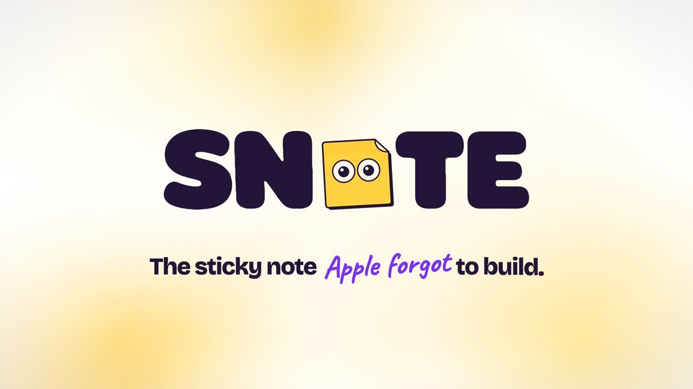

<p align="center">
  <picture>
    <source media="(prefers-color-scheme: dark)" srcset="docs/assets/logo-snote-dark.png">
    
  </picture>
</p>

<p align="center"><b>The sticky note Apple forgot to build.</b><br>
A sticky note that floats on top of every screen, every monitor, every Space — staring at you until you actually do the thing.</p>

<p align="center">
  <a href="https://github.com/rozgaarrhythms/snote/releases/latest/download/SNOTE-arm64.dmg"><b>↓ Download for macOS (Apple Silicon)</b></a> ·
  <a href="https://github.com/rozgaarrhythms/snote/releases/latest/download/SNOTE-x64.dmg">Intel Mac</a> ·
  <a href="https://snote-website.vercel.app">Website</a>
</p>

<p align="center">
  <a href="https://snote-website.vercel.app"></a>
</p>

---

## Why

Your notes app is where tasks go to die. Every digital sticky note makes the same mistake: it disappears into a tab, buried under 500 other tabs. A sticky note has exactly two jobs — **be visible** and **stick**.

SNOTE hovers over everything, the way a Google Meet window does. Switch apps, switch desktops, go full screen. Still there. Still judging.


## We removed the save button. On purpose.

Saving a sticky note is procrastination with extra steps. SNOTE gives you one option: **do the thing, then tear it up.** Hit ✕ and it's gone for good.

Your open notes do survive a restart — a note on your screen is a promise, not an archive.

## Install

1. Download the DMG for your Mac from the [latest release](https://github.com/rozgaarrhythms/snote/releases/latest).
2. Open it and drag **SNOTE** into **Applications**.
3. First launch: macOS will say it can't verify the developer (SNOTE isn't notarized — we're indie, not dangerous). Open **System Settings → Privacy & Security** and click **Open Anyway**. You only do this once.

Requires macOS 12 or later.

## Use

| | |
|---|---|
| New note | `⌘⇧N` from anywhere, or **+ New Note** |
| Move | drag the coloured header |
| Colour | the dots in the header |
| Format | **B** / *I* / U / ~~S~~ / lists / highlight — or `⌘B`, `⌘I`, `⌘U` |
| Done | ✕ → **Tear it up** |
| Menu bar 📝 | new note, show/hide all, **Open at Login**, quit |

## Build it yourself

```bash
npm install
npm run dev        # run with hot reload (or double-click "Start Sticky Notes.command")
npm run release    # build dist/SNOTE-arm64.dmg and dist/SNOTE-x64.dmg
```

Electron + React + TypeScript + Tiptap. Notes are plain JSON in `~/Library/Application Support/SNOTE/notes.json`. Dev notes on how the floating-window trick works live in [`skills/`](skills/knowledge.md).

## Contributing

Issues and pull requests are welcome — bug reports, ideas, roasts. The v3 idea on the table is a tiny floating orb that expands on hover; tell us if you want it.

Reviews from real users live on the thread at [snote-website.vercel.app](https://snote-website.vercel.app/#reviews).

## License

[MIT](LICENSE) © Manvendra Kumar
